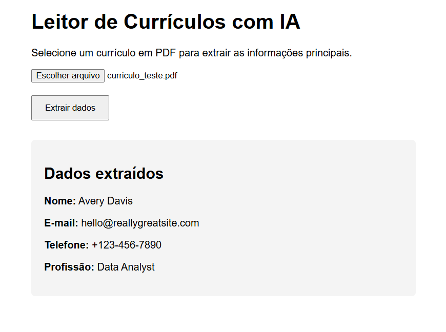

# Leitor de Currículos com IA

Aplicação web para extração de informações de currículos em PDF utilizando o Gemini 2.5 Flash. O usuário envia um arquivo e o sistema identifica nome, e-mail, telefone e profissão, retornando os dados de forma estruturada.

O front-end foi desenvolvido em React com TypeScript, enquanto o back-end utiliza FastAPI para receber os arquivos, extrair o texto dos PDFs e realizar as requisições ao Gemini.



## Tecnologias

- **React + TypeScript** — Interface da aplicação
- **Vite** — Ambiente de desenvolvimento do front-end
- **Python + FastAPI** — API para processamento dos arquivos
- **PyPDF2** — Extração de texto dos PDFs
- **Gemini 2.5 Flash** — Identificação das informações dos currículos

## Instalação e execução

### Pré-requisitos

- Python 3.10 ou superior
- Node.js e npm
- Chave de API do Gemini ([Google AI Studio](https://aistudio.google.com/))

### Back-end

Clone o repositório e acesse a pasta do back-end:

```bash
git clone https://github.com/SEU-USUARIO/pdf-summarizer.git
cd pdf-summarizer/backend
```

Crie e ative um ambiente virtual.

Windows (PowerShell):

```powershell
py -m venv venv
.\venv\Scripts\Activate.ps1
```

Linux/macOS:

```bash
python3 -m venv venv
source venv/bin/activate
```

Instale as dependências:

```bash
pip install -r requirements.txt
```

Crie um arquivo `.env` na pasta `backend` e configure a chave do Gemini:

```env
GEMINI_API_KEY=sua_chave_aqui
```

Inicie o servidor:

```bash
python -m uvicorn main:app --reload
```

A API ficará disponível em `http://localhost:8000`, com a documentação dos endpoints em `http://localhost:8000/docs`.

### Front-end

Em outro terminal, acesse a pasta `frontend`:

```bash
cd frontend
npm ci
npm run dev
```

Acesse `http://localhost:5173` para utilizar a aplicação.

## Funcionamento

Após o envio do currículo, a API extrai o texto do PDF usando PyPDF2 e encaminha o conteúdo ao Gemini. O modelo identifica os campos solicitados e retorna um JSON, que é utilizado pelo front-end para apresentar as informações.

Exemplo de resposta do endpoint `POST /upload`:

```json
{
  "status": "success",
  "file_name": "curriculo.pdf",
  "extracted_data": {
    "nome": "João Silva",
    "email": "joao@email.com",
    "telefone": "(11) 99999-9999",
    "profissao": "Desenvolvedor de Software"
  }
}
```

Os campos não identificados são retornados como `null`.

## Limitações

A extração de texto depende do conteúdo do PDF. Currículos digitalizados como imagem podem não funcionar corretamente, pois o projeto não implementa OCR.

O processamento também depende da disponibilidade da API do Gemini, e as informações retornadas pelo modelo podem conter imprecisões.
